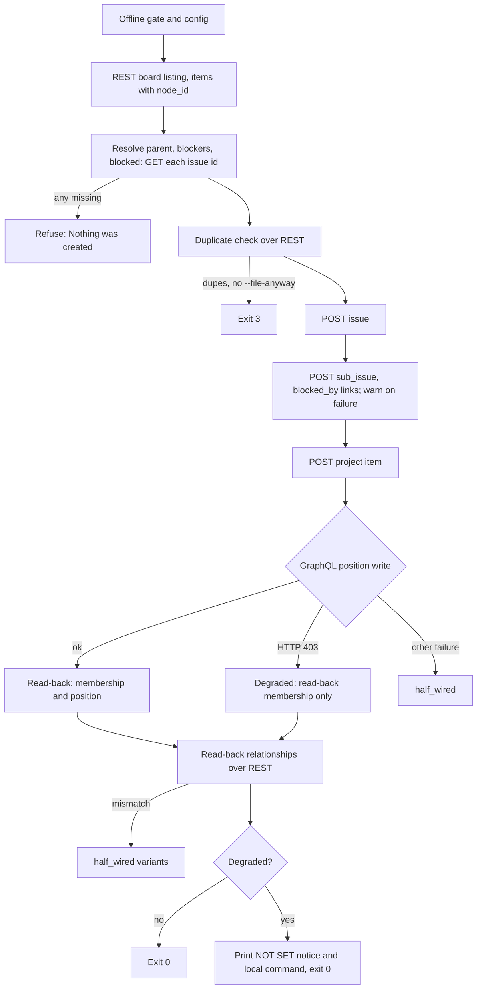

# File Issues Over GitHub's REST API - Plan

## Goal Capsule

- **Objective:** An agent in a Claude Code cloud session can create, adopt, link and comment on issues through this engine with the same read-back guarantee it has locally, and is told plainly when the one thing it cannot do there (board position) still needs a local run.
- **Means:** Every GitHub call moves to REST through `gh api` (KTD1); only the board-position write stays on GraphQL and degrades when refused (KTD2).
- **Authority:** Issue #14 and its 2026-10-15 comment are the issue of record. This plan's Requirements win on behavior; KTDs win on mechanism.
- **Stop conditions:** Stop and report if a REST endpoint this plan relies on turns out not to exist or not to return the field the read-back needs (KTD5, KTD6), if REST board order stops matching GraphQL board order on a multi-page board (Risks), or if the cloud proxy refuses a REST route this plan relies on (Verification Contract, cloud smoke).
- **Execution profile:** One branch, units in dependency order, the full test suite green after every unit.
- **Finishes and ships:** `ce-work` implements; the calling pipeline reviews and opens the PR.

---

## Product Contract

### Summary

The engine stops using GraphQL-backed `gh` commands (`gh issue create/edit/view/list/comment`, `gh project item-add`, `gh api graphql`) and talks to GitHub's REST API instead, locally and in the cloud. The board-position write has no REST route, so it stays GraphQL. When GitHub or a proxy refuses it with HTTP 403, the issue is still filed, verified, and left at the bottom of the board with a printed command a local session can run to place it. The test suite gains a mode that blocks every GraphQL call, and the docs say what degrades.

### Problem Frame

Claude Code cloud sessions reach GitHub through a proxy that rejects every GraphQL request with HTTP 403, even with a user-supplied `GH_TOKEN`. Every call this engine makes is GraphQL-backed today, so filing fails completely from the cloud. `jffriend/pluckd#577` needs filing to work there.

### Requirements

**Filing without GraphQL**

- R1. Create mode files an issue (title, body, shape labels, parent, blocked-by, blocks) and verifies it, with every GraphQL call refused.
- R2. Adopt mode reads an existing issue, refuses contradictions as today, writes only the missing relationships, and verifies, with every GraphQL call refused.
- R3. The board listing, the board-neighbourhood preview, the duplicate-title check and the adopt move record all work with every GraphQL call refused.
- R4. Read-back stays mandatory and reads every relationship and board membership through REST (KTD6).

**Board position**

- R5. When the position write is refused with HTTP 403, the run still exits 0, leaves the item where it landed, and prints a clear notice plus the exact command a local session runs to place it.
- R6. A position write that fails for any other reason is treated as today: a half-wired refusal.
- R7. With GraphQL available, positioning and its read-back behave exactly as today.

**Guidance**

- R8. Every remedy command the engine prints, and every command the skill template tells an agent to run, works without GraphQL.
- R9. `docs/USAGE.md` and `docs/CONCEPTS.md` say what degrades without GraphQL and how to finish the job.

### Key Decisions

- **REST everywhere, locally too.** One code path. (session-settled: user-directed — chosen over REST only in the cloud with GraphQL kept locally: one code path to test and trust.) Governs R1, R2, R3, R7.
- **Position degrades instead of failing.** (session-settled: user-directed — chosen over failing the filing when position cannot be set: no REST route for position is known.) Governs R5.
- **Blocked-by and blocks links use REST, with no degrade path.** Measured working on 2026-10-15 (issue #14 comment). (session-settled: user-directed — chosen over a skip-and-report fallback: REST supports the links.) Governs R1, R2.
- **Read-back stays mandatory, over REST.** (session-settled: user-directed — chosen over skipping read-back when GraphQL is blocked: read-back is the engine's core guarantee.) Governs R4.

### Scope Boundaries

- Not built: a cloud-detection switch. The engine never asks "am I in the cloud"; it reacts to the 403 on the one GraphQL call it still makes (KTD2). Evidence that would change this: a cloud proxy that answers GraphQL with something other than 403.
- Not built: an up-front GraphQL reachability probe. It would add a call whose transient failure locally would silently skip positioning. Evidence that would change this: the 403 turning out to arrive only after a long timeout.
- Not built: writing the project `Status` field. The engine does not write Status today (see Assumptions), so there is nothing to port.
- Not changed: the 30-second read-back ceiling, the retry bound, exit codes 0/1/3, the four placement questions, or the duplicate-check limit of 500 open issues (reading past it is #19).

#### Deferred to Follow-Up Work

- Orgs-owned project boards (`orgs/{org}/projectsV2/...`). The engine is user-board-only today (`user(login:)` in `board.sh`) and stays so.

### Sources

- Issue #14 and its comment (REST blocked-by measured on `jffriend/pluckd#577`).
- Claude Code cloud GitHub proxy: https://code.claude.com/docs/en/cloud-environments#github-proxy
- Measured 2026-10-15 from a local Mac, read-only:
  - `gh api users/jffriend/projectsV2/3/items` returned the 10 board items in the same order `board.sh` (GraphQL) returns them: 15, 14, 17, 4, 5, 6, 7, 9, 1, 19. Each item carries `id`, `node_id` (the `PVTI_...` id the position mutation takes) and `content.number`/`content.title`/`content.id`.
  - `gh api repos/jffriend/pluckd/issues/357/parent` returned `{number: 304}`; `gh api repos/jffriend/pluckd/issues/357` carries `parent_issue_url`.
  - `gh api repos/jffriend/ai-issue-management-skill/issues/15/dependencies/blocking` returned `[14]`.
- `docs/solutions/developer-experience/gh-issue-edit-is-not-idempotent-write-a-delta-not-a-set.md` — re-adding an existing link fails the call; adopt must keep writing a delta.
- `docs/solutions/best-practices/when-empty-is-a-legal-answer-a-guard-must-check-shape-not-emptiness.md` — the read-back must check reply shape, because an empty list is a legal answer.

---

## Planning Contract

### Key Technical Decisions

- KTD1. **All issue, link, comment and board reads go through `gh api` REST paths.** Mapping:

  | Today | REST |
  |---|---|
  | `gh issue create` | `POST repos/{repo}/issues` (title, body, labels) |
  | `--parent N` | `POST repos/{repo}/issues/{N}/sub_issues` with `sub_issue_id` = new issue's numeric `id` |
  | `--blocked-by B` | `POST repos/{repo}/issues/{NUM}/dependencies/blocked_by` with `issue_id` = B's numeric `id` |
  | `--blocking X` | `POST repos/{repo}/issues/{X}/dependencies/blocked_by` with `issue_id` = new issue's numeric `id` |
  | `gh issue view --json ...` | `GET repos/{repo}/issues/{n}` plus `.../dependencies/blocked_by` and `.../dependencies/blocking` |
  | `gh issue list` (dupes) | `GET repos/{repo}/issues?state=open&per_page=100`, paginated to the 500 limit, pull requests dropped |
  | `gh issue comment` | `POST repos/{repo}/issues/{n}/comments` |
  | `gh project item-add` | `POST users/{owner}/projectsV2/{number}/items` with the issue's numeric `id` |
  | `board.sh` GraphQL query | `GET users/{owner}/projectsV2/{number}/items`, paginated |
  | `projectItems` lookups | the item for an issue number is read from the REST board listing |

  (session-settled: user-directed — chosen over REST only in the cloud: one code path.) Governs R1, R2, R3.
- KTD2. **The position write stays `updateProjectV2ItemPosition` and is classified by its error.** Exit non-zero with `HTTP 403` in stderr means refused: record a degraded position and continue. Any other failure stays `half_wired`. (session-settled: user-directed — chosen over failing the filing: no REST position route is known.) Governs R5, R6, R7.
- KTD3. **Create resolves every referenced issue before it writes anything.** The parent, each blocker and each blocked issue are read once (`GET repos/{repo}/issues/{n}`) to get their numeric `id`. A number that does not exist refuses with "Nothing was created." Today's single create call made a missing number fail atomically; REST create is several calls, so checking first keeps a typo from leaving a half-wired issue.
- KTD4. **Create writes the issue first, then each link, then lets the read-back judge.** A failed link write prints a warning and continues, the way adopt's failed `gh issue edit` does today. The read-back is what proves state and picks the refusal. The window where the issue exists partly linked is accepted, locally as well as in the cloud. The create-mode HALF-WIRED remedy changes to lead with the exact `--adopt` command from `reverify_command`. That command writes only the missing links and re-reads everything, and it works without GraphQL. Deleting an issue needs GraphQL, so the "delete #N and re-run" alternative is printed only as a local-session option. Governs R8.
- KTD5. **Board item ids come from the REST listing.** The listing carries each item's `node_id`, so the "item after which to position", adopt's "item already on the board", and the auto-add fallback all read it from the listing instead of a per-issue GraphQL `projectItems` query. Membership corroboration (the second path when the listing is silent) becomes `GET users/{owner}/projectsV2/{number}/items/{item_id}` using the id item-add returned. When no item id is known, there is no corroboration and the refusal rests on the exhausted bound, as it already does.
- KTD6. **Read-back reads three REST replies and checks each one's shape.** The issue reply from `GET repos/{repo}/issues/{n}` is valid only if it carries `number` and `state`. In a valid reply, `parent_issue_url` absent or `null` means no parent; GitHub omits the key on parentless issues (measured 2026-10-15 on #19). When present it must be a string ending in a numeric segment, which is the parent number. Blocked-by and blocking come from the two dependency lists (each must be a JSON array; numbers compared as sets). An invalid issue reply, a malformed `parent_issue_url`, or a non-array list is COULD NOT LOOK (`half_wired_unreadable`), never a pass.
- KTD7. **The gh capability probe shrinks to "is `gh` on PATH".** It probed `gh issue create/edit` flags and `gh issue view --json` fields that the engine no longer uses. `gh api` has been stable far longer than the 2.94.0 floor the probe enforced. The version string is still printed for the record.
- KTD8. **A degraded position changes three things after the read-back.** The position comparison is skipped and reported as `board position  NOT SET`. Adopt's move comment is not written, because nothing moved. The run ends with the local-session command from `reverify_command`, which is corrected to include `--config` and the real script path.
- KTD9. **Remedy commands become REST.** Adopt's three refusal remedies print `gh api -X DELETE` forms: `repos/{repo}/issues/{parent}/sub_issue` with `sub_issue_id`, and `repos/{repo}/issues/{n}/dependencies/blocked_by/{id}` (for a blocks link, against the blocked issue). The numeric ids come from the replies adopt already read.
- KTD10. **The test fake keeps argv-substring matching.** Rules match REST paths (`repos/.../issues/7/dependencies/blocked_by`) instead of sub-commands. A harness option answers every argv containing `graphql` with exit 1 and `HTTP 403` in stderr. Board fixtures switch to the REST item shape.

### High-Level Technical Design

Create-mode write and verify sequence. Adopt is the same from "add to board" on, with the delta writes of today in place of the create block.

### Assumptions

- "Status" in issue #14's Done-when means the board listing still reads, since the engine never writes Status. `board.sh` keeps the Status field in its REST output (requested by its numeric field ID, see U1) so consumers that read it keep working.
- REST `POST users/{owner}/projectsV2/{number}/items` appends the new item at the bottom of the board, matching the "leave it at the bottom" wording of R5. Not measured; a write was out of bounds for planning. The read-back reports where it actually is either way.
- REST item-add on an issue already on the board (auto-add workflow) returns an error or no id, as GraphQL did. The existing fallback (look the item up by issue number) covers either.
- The `pages=… rows=… distinct=…` line and the rows-versus-distinct truncation check stay in `board.sh`; tests assert on that line.

### Sequencing

U1 first, because every other unit's tests need the REST-shaped fake and board fixtures. U2 to U6 follow the script top to bottom. U7 adds the GraphQL-blocked suite once every path is REST. U8 last.

---

## Implementation Units

### U1. REST board listing and test fake

- **Goal:** `board.sh` reads the board over REST and the test harness speaks REST.
- **Requirements:** R3, R7
- **Dependencies:** none
- **Files:** `board.sh`, `file_issue.sh` (`read_board`), `tests/test_engine_gating.py` (`FAKE_GH` rules, `board_page`, `Harness`)
- **Approach:**
  1. `board.sh` pages through `users/{owner}/projectsV2/{number}/items?per_page=100` by following the `Link` header's `after` cursor itself, so the page count and the 20-page cap survive. The `fields` parameter takes field IDs, not names (`fields=Status` returns HTTP 400). Look up the Status field's numeric ID once per run from `GET users/{owner}/projectsV2/{number}/fields` by `name == "Status"` and pass `fields=<id>`; omit `fields` when the project has no Status field.
  2. Output stays one JSON document per page, now the REST item array. The rows-versus-distinct self-check and its stderr line are unchanged.
  3. `read_board` emits `number<TAB>title<TAB>node_id` lines from the new shape. Callers that `cut -f1` keep working.
  4. `board_page` in the tests builds REST items; the board rule matches the `projectsV2/` items path.
- **Patterns to follow:** the existing page loop and self-check in `board.sh`.
- **Test scenarios:**
  - A two-page REST board is read in order and every number reaches the neighbourhood preview.
  - A board whose pages repeat (cursor not advancing) still fails with `TRUNCATED BOARD`.
  - A failed page read still fails the run as "not trustworthy".
  - The 20-page cap still fires.
  - The `pages=… rows=… distinct=…` line still prints for a config-driven board.
  - A board whose fields listing has a Status field requests it by numeric ID, and each item in the output carries its Status value.
- **Verification:** the existing board and neighbourhood tests pass against REST fixtures.

### U2. Probe and shared REST helpers

- **Goal:** Remove the flag probe and add the small helpers later units share.
- **Requirements:** R1, R2
- **Dependencies:** U1
- **Files:** `file_issue.sh` (`probe_gh_capability` and its helpers), `tests/test_engine_gating.py` (probe tests), `tests/test_engine_skill.py` if it pins probe text
- **Approach:**
  1. `probe_gh_capability` keeps only the not-on-PATH refusal and the printed version (KTD7). Delete `gh_flags_block`, the needed-flags table, the field probe and their refusals.
  2. Add a helper that returns an issue's numeric `id` by number and distinguishes "does not exist" (404) from "could not read".
  3. Add a helper that runs a `gh api` call, captures stderr, and reports whether a failure was HTTP 403 (used by U5).
- **Test scenarios:**
  - `gh` missing from PATH still refuses before any network call.
  - A run with no flag-probe responses in the fake proceeds (proves the probe no longer calls `--help`).
  - Probe tests for missing or unreadable flags are deleted, not left skipped.
- **Verification:** no `--help` or `issue view --json` call appears in any test's call log.

### U3. Create path over REST

- **Goal:** Create files and links an issue with REST only.
- **Requirements:** R1, R3
- **Dependencies:** U2
- **Files:** `file_issue.sh` (duplicate check, create block), `tests/test_engine_gating.py`
- **Approach:**
  1. Duplicate check reads open issues over REST up to `TITLES_LIMIT` raw entries, drops entries carrying `pull_request`, and feeds `issue_text.py dupes` the same `[{number,title}]` shape. The 500-limit warning fires when the raw listing reached `TITLES_LIMIT`, counted before pull requests are dropped, because open PRs consume the same pages.
  2. Before any write, resolve parent, blocker and blocked ids (KTD3).
  3. POST the issue with labels; read `number` and `html_url` from the reply. An empty or non-numeric number refuses as today.
  4. Write links per KTD1 and KTD4.
  5. Set the create-mode `HALF_WIRED_NEXT` text per KTD4.
- **Execution note:** Read `docs/solutions/developer-experience/gh-issue-edit-is-not-idempotent-write-a-delta-not-a-set.md` first.
- **Test scenarios:**
  - Create with parent, two blockers and one blocked issue sends one issue POST, one sub_issue POST and three blocked_by POSTs with the right ids, then passes read-back.
  - `--blocked-by 999` where #999 does not exist refuses before the issue POST, saying "Nothing was created."
  - The open-issue listing containing a pull request with a matching title is not reported as a duplicate.
  - A 500-entry listing prints the limit warning.
  - A 500-entry raw listing of which 100 are pull requests still prints the limit warning.
  - A failed blocked_by POST warns, continues, and the read-back refuses with the blocked-by mismatch. The remedy leads with a runnable `bash file_issue.sh --config … --adopt N …` command carrying the original four answers.
  - No call in the log contains `issue create` or `graphql` apart from the position mutation.
- **Verification:** every existing create-mode test passes with REST rules.

### U4. Adopt path over REST

- **Goal:** Adopt reads, refuses and writes its delta with REST only.
- **Requirements:** R2, R8
- **Dependencies:** U2
- **Files:** `file_issue.sh` (adopt post-fetch stage, adopt apply block), `tests/test_engine_gating.py`, `tests/test_engine_skill.py` (`REMEDY_CONSTRUCTION`, `GH_REMEDY_FLAGS`)
- **Approach:**
  1. Fetch state and body from `GET repos/{repo}/issues/{n}`, parent from `parent_issue_url`, and the two dependency lists. Keep the `has("state")` validity check and add shape checks per KTD6, including "no `parent_issue_url` key means no parent".
  2. Refusals print REST remedies per KTD9.
  3. The delta logic is unchanged; each missing link is its own POST, warned on failure as today.
- **Test scenarios:**
  - Adopt of an issue already holding every asked-for link issues no write and still reads back.
  - Adopt where the issue has a different parent refuses and prints the `DELETE .../sub_issue` remedy with the right numeric id.
  - Adopt with an unnamed blocked-by link prints the `DELETE .../dependencies/blocked_by/{id}` remedy.
  - Adopt with an unnamed blocks link prints the remedy against the blocked issue.
  - A closed issue still refuses.
  - The skill-drift test reads the new remedy construction and still fails if a remedy names a flag or path the script does not print.
- **Verification:** every existing adopt test passes with REST rules.

### U5. Board half over REST with degraded position

- **Goal:** Add the item over REST and degrade only on a refused position write.
- **Requirements:** R5, R6, R7
- **Dependencies:** U1, U2
- **Files:** `file_issue.sh` (`board_half`, `board_item_id` and its wrappers), `tests/test_engine_gating.py`
- **Approach:**
  1. Item-add posts the issue's numeric id; keep the returned `id` (for corroboration) and `node_id` (for position).
  2. Adopt's existing item and the auto-add fallback read `node_id` from the board listing (KTD5). Re-read the listing for the fallback, since a just-created issue is not in the pre-write listing.
  3. The `--after` item's `node_id` comes from the pre-write listing; the "could not be read" versus "absent" split is kept.
  4. The position mutation is classified per KTD2. On 403 set a `POSITION_DEGRADED` flag and continue.
  5. Delete `board_item_id`'s GraphQL query and the `boardMembershipCorroboration`/`boardItemByIssueNumber` markers; corroboration moves to the single-item GET.
- **Test scenarios:**
  - Position write answering HTTP 403 continues to read-back and the run exits 0.
  - Position write failing with HTTP 502 refuses with `half_wired` and the existing message.
  - Auto-added issue: item-add errors, the re-read listing supplies the node_id, and positioning proceeds.
  - `--after` item read failing refuses with `half_wired_unreadable`, never the delete remedy.
- **Verification:** the position and membership tests pass; the only GraphQL call left in the script is the position mutation.

### U6. Read-back and move record over REST

- **Goal:** Verify over REST and report a degraded position honestly.
- **Requirements:** R4, R5, R8
- **Dependencies:** U5
- **Files:** `file_issue.sh` (`read_back`, move-record block, `reverify_command`), `tests/test_engine_gating.py`
- **Approach:**
  1. Relationship read-back follows KTD6. Keep the three-state board logic and the latch unchanged.
  2. When `POSITION_DEGRADED` is set, membership is still proven (listing or corroboration, same retry bound) and the position comparison is skipped (KTD8).
  3. The move comment is a REST POST and is skipped when degraded.
  4. Degraded runs end with a stderr notice: position not set because GitHub refused the GraphQL position write, the item is wherever it landed, and the exact `bash file_issue.sh --config … --adopt N …` command to run locally.
- **Execution note:** Read `docs/solutions/best-practices/when-empty-is-a-legal-answer-a-guard-must-check-shape-not-emptiness.md` before changing the shape checks.
- **Test scenarios:**
  - Covers R4: a `{"message":"Not Found"}` reply for the dependency list refuses as COULD NOT LOOK, not `ok (none)`.
  - An issue reply missing `number`/`state` refuses as COULD NOT LOOK.
  - A valid issue reply with no `parent_issue_url` key reads back as no parent and passes a `--no-parent` filing.
  - `parent_issue_url` pointing at #240 when #240 was asked for passes.
  - Degraded create: membership proven, prints `board position  NOT SET`, the local command includes `--config`, exits 0.
  - Degraded create where the item never appears in the listing and corroboration fails still refuses with `half_wired_absent`.
  - Degraded adopt that would have moved the issue writes no comment.
  - Non-degraded adopt move still posts the comment over REST, and a failed comment still warns without failing.
- **Verification:** all read-back tests pass, including the latch and retry-bound tests.

### U7. GraphQL-blocked suite

- **Goal:** Prove the Done-when with every GraphQL call refused.
- **Requirements:** R1, R2, R3, R5
- **Dependencies:** U3, U4, U6
- **Files:** `tests/test_engine_gating.py`
- **Approach:** add the harness option from KTD10 and a test class that runs the main flows under it.
- **Test scenarios:**
  - Covers R1: create with parent and links, GraphQL blocked, exits 0 with every relationship `ok` and position `NOT SET`.
  - Covers R2: adopt that writes one missing link, GraphQL blocked, exits 0.
  - Covers R3: `--dry-run` with GraphQL blocked prints the neighbourhood and duplicate check and writes nothing.
  - Possible duplicates with GraphQL blocked still exit 3 with nothing written.
  - Across the class, the only argv containing `graphql` is the position mutation.
- **Verification:** the class passes and fails if any path reintroduces a GraphQL call.

### U8. Docs and skill template

- **Goal:** Tell users and agents what degrades without GraphQL and how to finish.
- **Requirements:** R8, R9
- **Dependencies:** U6
- **Files:** `docs/USAGE.md`, `docs/CONCEPTS.md`, `docs/SETUP.md`, `SKILL.template.md`, `file_issue.sh` (header help block)
- **Approach:**
  1. USAGE: a short section on cloud sessions, the `NOT SET` notice and the local command; replace `gh issue edit --remove-*` remedies with the REST forms.
  2. CONCEPTS: replace the gh version-gap section (KTD7 removed that guard) with one on the position degrade; update the delta-write section to cite REST errors without changing the lesson.
  3. SETUP: `project_id` is now only for positioning.
  4. SKILL.template.md: comment and body-edit instructions use `gh api` REST forms so they work in the cloud.
- **Test expectation:** none beyond `tests/test_engine_skill.py` passing -- docs only.
- **Verification:** no doc tells a reader to run a GraphQL-backed `gh issue`/`gh project` command for a step the engine supports.

---

## Verification Contract

| Gate | Command | When |
|---|---|---|
| Full suite | `python3 -m unittest discover tests` | after every unit |
| GraphQL-blocked class | the U7 class in `tests/test_engine_gating.py` | after U7 and before shipping |
| Live local smoke | `bash file_issue.sh --config config.json --dry-run …` against project 3 | once, after U6, read-only |
| Cloud smoke | From a real Claude Code cloud session: `bash board.sh --config config.json <out>`, then a `--dry-run`, then one real filing to this repo's board | before merge; needs a person to start the cloud session |

CI runs the full suite on push (`.github/workflows/tests.yml`). Every measurement behind this plan was taken from a local Mac. The proxy docs scope cloud API access to the repositories attached to the session, and the board is a user-owned route (`users/{owner}/projectsV2/...`). So the fake 403 in U7 cannot prove the cloud works. Only the cloud smoke can.

## Definition of Done

- Every requirement R1 to R9 has a passing test or a doc change that carries it.
- `grep -n 'gh issue\|gh project\|projectItems' file_issue.sh board.sh` finds no live call, only comments if any.
- The only `graphql` call in `file_issue.sh` is `updateProjectV2ItemPosition`.
- The full suite passes locally; the read-only dry-run against project 3 shows the same neighbourhood order as before the change.
- Deleted probe code and probe tests are gone, not commented out.
- The cloud smoke has run and passed, or the PR states plainly that it has not and that filing from the cloud is unproven.

---

## Risks

| Risk | Mitigation |
|---|---|
| REST board order differs from board order on a multi-page board (only a 10-item, one-page board was measured). | The dry-run smoke compares orders; `jffriend/pluckd`'s larger board is the better check if reachable. Stop condition in the Goal Capsule. |
| REST item-add takes a different body than assumed (numeric id versus owner/repo/number). | Confirm against GitHub's REST Projects docs during U5; the reply shape is checked before use. |
| Create is no longer one atomic call, so a mid-sequence failure leaves a partly linked issue, locally and in the cloud. | KTD3 removes the typo case; the read-back names exactly what is missing and prints an `--adopt` command that finishes it without GraphQL (KTD4). |
| The cloud proxy blocks user-owned Projects routes, so the board read fails before the position fallback is reached. | Cloud smoke in the Verification Contract; a stop condition in the Goal Capsule. |
| GitHub returns 403 for a reason other than the proxy (token lacks project scope) and position silently degrades locally. | The notice is loud and prints the fix command; a 403 on a write is a refusal either way, matching R5's wording. |
