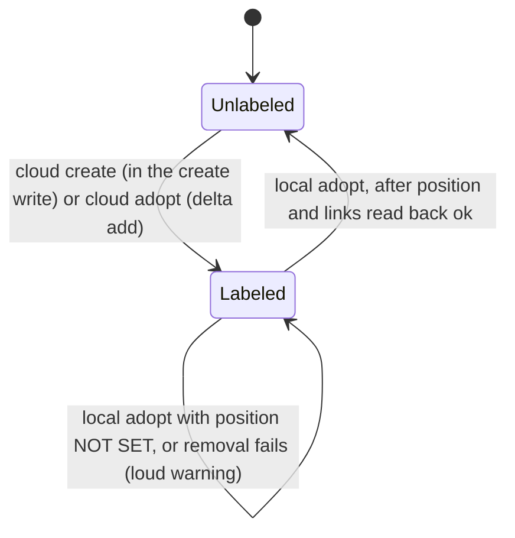

# File and Adopt Issues From a Cloud Session - Plan

## Goal Capsule

- **Objective:** An agent in a Claude Code cloud session can file and adopt issues through this engine, with everything the cloud allows written and read back, and every such issue plainly marked as not yet on the board so Joe can find it and place it.
- **Means:** A cloud mode that skips the board entirely, defers the position answer, and tags the issue with a `needs-board` label.
- **Authority:** Issue #14 and its 2026-10-16 comments (cloud smoke and read-only probe) are the issue of record. This plan's Requirements win on behavior.
- **Open blockers:** None for planning. Two facts are measured only in the acceptance run: whether cloud sessions expose an identifying environment variable (R1), and whether the cloud proxy allows the repo-scoped writes (Dependencies / Assumptions).
- **Stop conditions:** Stop and report if a change would make any local (non-cloud) run behave differently other than R15/R16, if the label comparison cannot live inside the shared read-back block without breaking `OneImplementation`, or if the acceptance run finds a repo-scoped write refused by the cloud proxy.
- **Execution profile:** One branch, units in dependency order, `python3 -m unittest discover tests` green after every unit.
- **Finishes and ships:** `ce-work` implements; the calling pipeline reviews and opens the PR. The cloud acceptance run (Success Criteria) happens after merge, from a cloud session Joe opens.

---

## Product Contract

### Summary

Cloud mode turns on by itself in a Claude Code cloud session, or with `--no-board` anywhere. In it, the engine creates or adopts the issue, runs the duplicate check, writes parent and blocking links, and reads all of it back, without touching the board. The position answer is deferred, the issue carries a `needs-board` label, and the run says plainly that the issue still needs placing from a local session.

### Problem Frame

Nothing in this engine works from a cloud session today. The session's GitHub proxy refuses every path outside `repos/{owner}/{repo}/...`, which includes the user-owned project board. `board.sh` fails first, and `file_issue.sh` then refuses to file because "the board listing is not trustworthy."

That refusal is correct for a local run, where a failed board read can hide a duplicate. In the cloud the board is simply out of reach, and most of the engine's work (create, duplicate check, links, read-back) needs only repo-scoped calls, which the read-only probe on 2026-10-16 showed working.

Joe keeps the board to active work and places issues himself, so a cloud filing does not need to reach the board automatically. It needs to be findable and honest about where it stands.

### Key Decisions

- **Detect cloud mode from the session's environment, with `--no-board` as the fallback.** A bad local token must still stop the run rather than quietly file off-board. (session-settled: user-directed — chosen over a flag alone, switching on a refused board read at start, and a config key: an environment signal removes cloud friction without giving the untrusted-board stop an exemption.) Governs R1, R2, R3.
- **`--no-board` unlocks cloud mode only after the cloud proxy itself refuses the board.** Review found that a flag honoured in any session let a local run get past "the board listing is not trustworthy". (session-settled: user-directed — chosen over keeping it in any session, keeping it with a loud warning, and dropping the flag: closes the bypass and keeps the fallback for a cloud session without the environment signal.) Governs R2, R3.
- **Every cloud run says the board was not checked, never that the issue is off it.** Project 3 auto-adds sub-issues at the bottom, and an adopted issue may already be placed, so "not on the board" can be false. (session-settled: user-directed — chosen over "NOT on the board yet" everywhere and over splitting by no-parent create: the line stays true on any consumer's board.) Governs R14.
- **The handoff is the `needs-board` label alone.** (session-settled: user-directed — chosen over GitHub's project auto-add workflow, auto-add plus label, and a label plus a local placement command: Joe keeps the board to active work and places issues by hand; the local command is deferred.) Governs R8, R9, R15.
- **The position answer is deferred, not guessed.** A cloud agent cannot see the board, so any position it gave would be blind. (session-settled: user-directed — chosen over requiring `--after`/`--top` as recorded intent, and over recorded intent with a mandatory local re-confirm.) Governs R5, R6, R7.
- **The label goes on in the same write that creates the issue.** A cloud-filed issue can then never exist without it. (session-settled: user-directed — Joe's proposal, chosen over a separate label write after create.) Governs R8.
- **`--after` and `--top` are refused in cloud mode rather than ignored.** (session-settled: user-approved — proposed with the tradeoff that an agent unaware of cloud mode needs one re-run.) Governs R6.
- **A local adopt that places a labeled issue clears the label.** Otherwise the label outlives its reason. (session-settled: user-approved.) Governs R15, R16.
- **No cross-repo link rule is needed.** The engine only names and writes links to issues in the configured repo, and existing cross-repo links are read through this repo's own dependency lists, which the cloud allows. (session-settled: user-approved.)

### Requirements

**Entering cloud mode**

- R1. Cloud mode turns on before any network call when the session's environment identifies a Claude Code cloud session.
- R2. `--no-board` turns cloud mode on only when the board read is refused with the cloud proxy's "sessions are bound to their configured repositories" message. Any other board failure stops the run as R3 says, and a board that reads fine refuses `--no-board`.
- R3. Outside cloud mode, a refused or unreadable board still stops the run exactly as today; no network failure switches a run into cloud mode.
- R4. A cloud-mode run says near the top of its output that it is in cloud mode and which of R1 or R2 turned it on.

**Placement answers**

- R5. In cloud mode the position answer is an explicit "decided later" answer; parent, blocked-by and blocks stay required as today.
- R6. In cloud mode `--after` and `--top` are refused, and the refusal names the "decided later" answer.
- R7. Outside cloud mode the "decided later" answer is refused, so a local filing still answers all four placement questions.

**What a cloud run does**

- R8. Create mode creates the issue with its shape labels and `needs-board` in one write, after the duplicate check, then writes parent, blocked-by and blocks.
- R9. Adopt mode reads the issue, including its title, from the issue itself, refuses contradictions as today, writes only the missing links, and adds `needs-board` only if it is absent.
- R10. A cloud run makes no board call of any kind: no listing, no add, no position write, no move comment.
- R11. `--dry-run` in cloud mode prints the duplicate check (create mode) and the summary, says that no board neighbourhood is available in this mode, and writes nothing.

**Read-back and reporting**

- R12. Read-back stays mandatory in cloud mode: parent, blocked-by, blocks and the `needs-board` label are each read back and compared, with the same shape checks and three-state outcome as today.
- R13. In cloud mode the board-membership and board-position read-back lines say "not checked (cloud mode)", never "ok".
- R14. A cloud run whose writes all read back matching exits 0. Its closing line says the board was not checked from the cloud, that the issue may already be on it at a spot nobody chose (sub-issues can be auto-added at the bottom), and that it carries `needs-board`; a notice says to place it from a local session.

**Clearing the label**

- R15. A local adopt that places an issue carrying `needs-board` removes the label only after every relationship and the position read back matching, then reads back the removal.
- R16. If removing the label fails or does not read back, the run says so loudly and names the command to finish it; the placement itself stands and is not undone.

**Agent instructions and docs**

- R17. `SKILL.template.md` tells an agent that in a cloud session it gives the "decided later" position answer; that if the board read is refused with the cloud proxy's "sessions are bound to their configured repositories" message, it re-runs with `--no-board`, the one named exception to "never work around a refusal"; that in cloud mode a preview shows no neighbourhood and the position is reported as decided later; that it relays the notice's `(--after N | --top)` command with the position left to the caller; that a missing `needs-board` label is fixed only with the command the engine prints; that it quotes the read-back and the notice to the caller; and that it never reaches the board any other way.
- R18. The user docs describe cloud mode, what it can and cannot do, the `needs-board` label, and how a labeled issue gets placed locally.

### Acceptance Examples

- AE1. Cloud filing succeeds. **Covers R1, R5, R8, R12, R13, R14.**
  - **Given:** a cloud session, a new title with no duplicates, a parent, and `--blocked-by none --blocks N` for an open issue N in this repo.
  - **When:** the agent runs create mode with the "decided later" position answer.
  - **Then:** the issue exists with its shape label and `needs-board`; parent, blocks and the label read back ok; board membership and position read "not checked (cloud mode)"; the closing line says the board was not checked and the issue may already be on it; exit 0.
- AE2. Position given in cloud mode. **Covers R6.**
  - **Given:** a cloud session.
  - **When:** the agent passes `--after 12`.
  - **Then:** the run refuses before any write and names the "decided later" answer.
- AE3. Bad local token. **Covers R3.**
  - **Given:** a local session with no cloud environment signal and no `--no-board`, whose token lacks project access.
  - **When:** the board read is refused with HTTP 403.
  - **Then:** the run stops with "the board listing is not trustworthy" and writes nothing, as today.
- AE4. Cloud adopt of an already-labeled issue. **Covers R9, R12.**
  - **Given:** an open issue that already carries `needs-board` and its parent.
  - **When:** a cloud adopt names that parent and one new blocks link.
  - **Then:** only the blocks link and no label are written; parent, links and label all read back ok.
- AE5. Local placement clears the label. **Covers R15, R16.**
  - **Given:** an issue filed from the cloud carrying `needs-board`.
  - **When:** a local adopt places it with `--after N`.
  - **Then:** after position and relationships read back ok, the label is removed and its absence reads back. If removal fails, a loud warning names the command to finish it and the placement stands.
- AE6. Cloud dry run. **Covers R11.**
  - **Given:** a cloud session.
  - **When:** the agent runs create mode with `--dry-run`.
  - **Then:** the duplicate check and summary print with a line saying no board neighbourhood is available; nothing is written.

### Success Criteria

- One real create-mode filing from a Claude Code cloud session reads back ok for parent, links and `needs-board` (AE1). This is the first measurement of cloud writes.
- The same cloud session records whether an identifying environment variable exists, and its name.
- That issue is then placed by a local adopt and its label cleared (AE5).
- Both results are recorded as a comment on #14.

### Scope Boundaries

- Deferred: a local command that lists every `needs-board` issue ready to place, filed as #24 (blocked by #14).
- Not built: GitHub's project auto-add workflow.
- Not built: attaching other repos to a cloud session, or any cross-repo link write.
- Separate: board Status and other board fields (#9, #7); cross-repo same-number matching (#22, blocked by #14); reading past 500 open issues in the duplicate check (#19).
- Not changed locally: every guard and output outside cloud mode, apart from the label clearing in R15 and R16.

### Dependencies / Assumptions

- Cloud writes are unmeasured. This plan assumes the proxy allows `POST` to the repo's issues, sub-issues, dependencies and labels, since all are under `repos/{owner}/{repo}/...`. If the acceptance run finds one refused, stop and report: the design changes.
- R1 assumes Claude Code cloud sessions set an identifying environment variable. Not verified. If none exists, R1 is dropped and cloud mode turns on through `--no-board` alone, with R17 carrying the agent through.

### Outstanding Questions

**Deferred to Implementation**

- Whether `CLAUDE_CODE_REMOTE=true` is the variable cloud sessions set (KTD2). Confirmed only by the acceptance run.
- How GitHub answers a create that names a label the repo does not have yet (KTD5). Measured in the acceptance run; the read-back catches either outcome.

### Sources / Research

- Issue #14, comments of 2026-10-16: the cloud smoke ("sessions are bound to their configured repositories ... (HTTP 403)") and the read-only probe listing what works and what is refused.
- `file_issue.sh`: `read_board` and the `BOARD_ROWS="$(read_board "$BOARD_JSON")" || exit 1` stop; the duplicate check's `gh_api "repos/$REPO/issues?state=open&per_page=100&page=$titles_page"`; adopt's `ADOPT_TITLE` taken from `BOARD_ROWS`; `write_links` and `post_link`, which write only to `repos/$REPO/...`; labels set only at create through `LABEL_FIELDS` on `POST repos/$REPO/issues`; no label add or remove anywhere.
- `docs/plans/2026-10-15-1453-feat-rest-api-filing-plan.md`: "Not built: a cloud-detection switch." This plan builds one, for the board as a whole, which that plan did not reach.
- `docs/CONCEPTS.md`, "Board Position Degrades Instead of Failing" and "A Truncated Board Listing Is a Hard Stop": the guards cloud mode must leave intact outside cloud mode.
- `docs/solutions/best-practices/the-exemption-that-makes-a-guard-writable-is-the-hole.md`: why R3 forbids any failure-triggered switch into cloud mode.

**Product Contract preservation:** Product Contract unchanged except Outstanding Questions, whose planning-owned items are resolved in place by KTD3–KTD5.

---

## Planning Contract

### Key Technical Decisions

- KTD1. **One `CLOUD` switch, set right after argument parsing, gates every board touchpoint.** Each board call site checks this one global rather than inferring cloud mode from a failure, so R3 holds by construction. A companion `CLOUD_REASON` records which of R1/R2 turned it on, for R4's line. Governs R1–R4, R10.
- KTD2. **Detection reads `CLAUDE_CODE_REMOTE` and accepts only the exact value `true`.** No repo evidence names the variable; this is Claude Code's documented remote-session flag from general knowledge, so the acceptance run confirms it. Any other value, or absence, leaves cloud mode off unless `--no-board` is given. (session-settled: user-directed — chosen over a flag alone, switching on a refused board read, and a config key: a bad local token must still stop.) Governs R1, R3.
- KTD3. **The "decided later" answer is the flag `--position-later`.** It reads as the position question's third answer beside `--after N` and `--top`, and matches the explicit-answer style of `--no-parent`. Governs R5–R7.
- KTD4. **The label name is a fixed engine constant, `needs-board`, not a config key.** It is engine vocabulary (what the engine could not do), not a consumer's issue shape, so it does not belong beside `shapes` in config. Making it configurable later is cheap: no consumer depends on another name yet.
- KTD5. **The engine does not create the label up front.** GitHub may create a missing label on the issue-create call or may drop it; the read-back (R12) proves which, and a missing label after create is a loud refusal, never a silent pass. Building label creation now would add a write the cloud has not been measured on. Revisit after the acceptance run.
- KTD6. **The label check lives inside the shared read-back block and reads the `labels` array already in the issue reply.** No new call and no new retry bound for the create/adopt read-back. The reply must carry a `labels` array before its contents are trusted, per `docs/solutions/best-practices/when-empty-is-a-legal-answer-a-guard-must-check-shape-not-emptiness.md`. Governs R12.
- KTD7. **Label writes are deltas.** Adopt adds `needs-board` only when the pre-fetched issue lacks it; local placement removes it only when the pre-fetched issue has it. GitHub's answer to a duplicate add or an absent remove is unmeasured, so neither is ever sent, per `docs/solutions/developer-experience/gh-issue-edit-is-not-idempotent-write-a-delta-not-a-set.md`. Governs R9, R15. (session-settled: user-approved — chosen over leaving the label for manual removal: the label would outlive its reason.)
- KTD8. **Label removal copies the move-record failure shape.** After a full read-back with a placed (not degraded) position, remove the label, then read the issue fresh to prove it is gone. Failure prints a `####` stderr banner with the exit code, gh's error text, and the exact `gh api -X DELETE repos/<repo>/issues/N/labels/needs-board` command, and the run still exits 0. It never calls `die` or a `half_wired_*` helper, whose delete-and-refile advice would be wrong on a correctly placed issue. Governs R15, R16.
- KTD9. **The existing `board position NOT SET` path stays.** It still serves a session that can reach the board over REST but not GraphQL. The cloud smoke showed a cloud session never reaches it, so its docs stop calling it the cloud path. Deleting it is out of scope; it ships tested and harms nothing.
- KTD10. **Printed recovery commands are cloud-aware.** `reverify_command` and `half_wired_head` print `--position-later` in cloud mode, since a cloud session re-running a printed command would otherwise hit the R6 refusal, and today they would print a bare `--after` when no position was given.
- KTD11. **The test harness unsets `CLAUDE_CODE_REMOTE` by default.** `Harness.run` copies the caller's environment, so a suite run inside a cloud session would silently turn every existing test into a cloud run. Cloud tests set it explicitly.

### High-Level Technical Design

Which position answers a run accepts, by mode (R5–R7):

| Mode | `--after N` / `--top` | `--position-later` | none given |
|---|---|---|---|
| Local | accepted, checked against the board | refused | refused ("no board-position answer") |
| Cloud (env `true` or `--no-board`) | refused, names `--position-later` | accepted | refused, names `--position-later` |

The `needs-board` label's lifecycle on one issue:

What a cloud run does, in order: parse, set `CLOUD`, validate answers offline, gh probe, adopt pre-fetch (adopt), duplicate check (create), summary, dry-run stop, create with labels or adopt delta writes, link writes, read-back of parent, links and label, closing line and notice. The board listing, neighbourhood, `--after` check, `board_half`, the board half of read-back, and the move record are all skipped.

### Assumptions

- `CLAUDE_CODE_REMOTE=true` marks a Claude Code cloud session (KTD2). If the acceptance run finds otherwise, change the one detection check; `--no-board` keeps working either way.
- The cloud proxy allows POST to `repos/{owner}/{repo}/issues`, `.../sub_issues`, `.../dependencies/blocked_by`, and `.../labels`. Unmeasured; the acceptance run is the first test.
- Nothing enforces `SKILL.template.md`: no test reads it since extraction. This plan adds none; that belongs with the installed skill wrapper (#1).

### Risks

| Risk | Mitigation |
|---|---|
| A board touchpoint is missed and a cloud run still calls `projectsV2` or GraphQL. | Cloud tests assert no call contains `projectsV2` or `graphql` (U2). |
| The label read-back passes on a malformed reply. | Shape check on `labels` before comparing, plus a wrong-shape test (U3). |
| Removing the label on an issue whose position did not land. | Removal runs only after a placed, non-degraded position read-back (KTD8, U4). |
| Local behaviour drifts. | The full existing suite stays green with the harness unsetting the cloud variable (KTD11). |

---

## Implementation Units

### U1. Cloud-mode switch and placement-answer rules

- **Goal:** Decide cloud mode before any network call and enforce which position answers each mode accepts.
- **Requirements:** R1–R7; KTD1, KTD2, KTD3, KTD11.
- **Dependencies:** none.
- **Files:** `file_issue.sh`, `tests/test_engine_gating.py`, `tests/test_engine_skill.py`.
- **Approach:**
  1. Add `--no-board` and `--position-later` arms to the existing `case "$1" in` parser, with defaults beside the other defaults.
  2. Right after parsing, set `CLOUD` and `CLOUD_REASON` from `CLAUDE_CODE_REMOTE=true` or `--no-board`.
  3. Rework the position-answer validation block to the mode table in High-Level Technical Design; every refusal ends with `$NOTHING`.
  4. Print the R4 line before the gh capability probe line.
  5. Make `Harness.run` delete `CLAUDE_CODE_REMOTE` unless a test sets it; add the new flags to `FlagsMatchTheScript`.
- **Patterns to follow:** the `--after`/`--top` contradiction checks; `RequiredFlags` tests.
- **Test scenarios:**
  - Covers AE2. Cloud via env, `--after 12` → exit 1, output names `--position-later`, no network write.
  - Cloud via `--no-board`, `--top` → exit 1, names `--position-later`.
  - Cloud with no position answer → exit 1, names `--position-later`.
  - Local with `--position-later` → exit 1, says it is cloud-only.
  - `CLAUDE_CODE_REMOTE=false` or `1` → local mode (an `--after` run proceeds as today).
  - Env and `--no-board` both set → cloud mode; R4 line names what turned it on.
  - R4 line appears before `gh capability`.
- **Verification:** All position-answer refusals happen offline; existing suite unchanged.

### U2. Skip the board in cloud runs

- **Goal:** A cloud run makes no board call and still reaches the duplicate check, the writes, and the read-back.
- **Requirements:** R9 (title), R10, R11, R13; KTD1, KTD10.
- **Dependencies:** U1.
- **Files:** `file_issue.sh`, `tests/test_engine_gating.py`.
- **Approach:**
  1. Skip the top-level `read_board`, the `--after` board check, and the neighbourhood block when `CLOUD`; print R11's "no board neighbourhood in cloud mode" line instead.
  2. Take the adopt summary title from `ADOPT_JSON` in cloud mode.
  3. Skip the adopt position-summary block; keep `ADOPT_MOVED` at 0.
  4. Have `board_half` return early in cloud mode, keeping its bare-line call site for `OneImplementation`.
  5. In `read_back`, skip the board retry loop and verdict in cloud mode and print `board membership   not checked (cloud mode)` and `board position     not checked (cloud mode)`.
  6. Make `reverify_command` and `half_wired_head` print `--position-later` in cloud mode.
  7. Add a harness rule that answers any `projectsV2` path with the proxy's 403 text, for AE3.
- **Patterns to follow:** `GraphQLBlocked.tearDown`'s call-scanning assertion; fixed-width read-back labels.
- **Test scenarios:**
  - Cloud create: no call contains `projectsV2` or `graphql`.
  - Cloud adopt: summary shows the issue's real title from the issue reply.
  - Covers AE6. Cloud `--dry-run`: duplicate check and summary print, the no-neighbourhood line prints, nothing written, exit 0.
  - Covers AE3. Local run with `projectsV2` answering 403 → "the board listing is not trustworthy", exit 1, nothing written.
  - Cloud read-back prints both board lines as "not checked (cloud mode)" and never "ok".
  - A cloud half-wired failure prints a recovery command containing `--position-later` and no `--after`.
- **Verification:** Cloud tests pass with the board refused; `OneImplementation` and every existing board test still pass.

### U3. The `needs-board` label on cloud runs

- **Goal:** Every cloud-filed or cloud-adopted issue carries `needs-board`, proven by read-back, and the run says plainly it is not on the board.
- **Requirements:** R8, R9, R12, R14; KTD4–KTD7.
- **Dependencies:** U2.
- **Files:** `file_issue.sh`, `tests/test_engine_gating.py`.
- **Approach:**
  1. In cloud create, append `needs-board` to the labels sent in the create call.
  2. In cloud adopt, add the label with one delta write only when `ADOPT_JSON` lacks it.
  3. Add one label parser helper outside the shared read-back block, beside `issue_reply_parent`: given an issue reply it prints present, absent, or BAD when the reply has no `labels` array. Adopt's pre-fetch, the read-back, and U4's post-removal check all call it.
  4. Inside the shared read-back block, compare the helper's answer for `needs-board`; add only this comparison's variable names to `COMPARISON_TOKENS`. Print a `needs-board` read-back line in the same column style.
  5. A missing label after a cloud write is a half-wired refusal whose remedy is the exact label-add command.
  6. Add the cloud closing line and stderr notice (R14) as a third branch beside the existing `POSITION_DEGRADED` branches.
  7. Give the fake `issue_reply()` a `labels` key with and without `needs-board`.
- **Patterns to follow:** `LABEL_FIELDS`; the `REL_JSON` shape check; the NOT SET closing branch.
- **Test scenarios:**
  - Covers AE1. Cloud create: the create call carries the shape label and `needs-board`; read-back shows parent, links and label ok; closing line says not on the board; exit 0.
  - Covers AE4. Cloud adopt of an issue already labeled: no label write, label reads back ok.
  - Cloud adopt of an unlabeled issue: exactly one label add, then read back ok.
  - Label absent in the read-back reply after a cloud create → exit 1 with the label-add remedy.
  - Read-back reply missing the `labels` key → refused as unreadable, never ok.
  - Local create: no `needs-board` in the create call and no label read-back line.
- **Verification:** Cloud runs exit 0 only when the label read back present.

### U4. Local placement clears the label

- **Goal:** A local adopt that places a labeled issue removes `needs-board` and proves it.
- **Requirements:** R15, R16; KTD7, KTD8.
- **Dependencies:** U3.
- **Files:** `file_issue.sh`, `tests/test_engine_gating.py`.
- **Approach:**
  1. After the local adopt read-back and move record, if `ADOPT_JSON` had `needs-board` and `POSITION_DEGRADED` is 0, delete the label.
  2. Read the issue fresh and confirm the label is gone through U3's label parser helper, with its own variable names. This is a post-placement check, not a second relationship comparison, so it stays outside the shared read-back block and adds nothing to `COMPARISON_TOKENS`.
  3. Print `needs-board        removed` on success, or the KTD8 banner on failure; exit 0 either way.
- **Patterns to follow:** the move-record block and `AdoptRecordsTheMove` tests.
- **Test scenarios:**
  - Covers AE5. Local adopt of a labeled issue, position lands → one label DELETE, fresh read shows it gone, "removed" line, exit 0.
  - DELETE fails → banner with the exact DELETE command, exit 0, no `half_wired` text.
  - DELETE succeeds but the fresh read still shows the label → banner, exit 0.
  - Local adopt of an unlabeled issue → no label DELETE.
  - Local adopt of a labeled issue with position NOT SET → no label DELETE.
  - Local adopt `--dry-run` of a labeled issue → no DELETE.
- **Verification:** Removal never runs before a placed position reads back.

### U5. Agent instructions and docs

- **Goal:** Agents and readers know when cloud mode applies, what it does, and how a labeled issue gets placed.
- **Requirements:** R17, R18; KTD9.
- **Dependencies:** U1–U4.
- **Files:** `SKILL.template.md`, `file_issue.sh` (help block), `docs/USAGE.md`, `docs/CONCEPTS.md`, `docs/SETUP.md`, `tests/test_engine_gating.py` (`Usage` test).
- **Approach:**
  1. `SKILL.template.md`: add `--position-later` as the cloud-only position answer, the re-run-with-`--no-board` rule for the proxy's refusal message, quoting the not-on-the-board notice, and "never reach the board another way"; retitle the NOT SET outcome so it no longer names cloud sessions.
  2. Help block: add both flags and a cloud-mode paragraph; narrow "WHERE GRAPHQL IS REFUSED" to sessions that reach the board but not GraphQL.
  3. `docs/USAGE.md`: replace "Filing from a cloud session" with cloud mode, `--position-later`, the label, and placing a labeled issue with a local adopt; amend "There's no equivalent of no position" for cloud mode.
  4. `docs/CONCEPTS.md`: add a cloud-mode entry beside "Board Position Degrades Instead of Failing" and correct that entry's cloud claim; amend the four-answers paragraph.
  5. `docs/SETUP.md`: note that cloud mode needs no extra config and that `needs-board` may need creating once if the acceptance run shows GitHub does not create it.
- **Patterns to follow:** existing section voice in each doc; no line-number citations.
- **Test scenarios:**
  - `--help` output contains `--no-board` and `--position-later`.
- **Verification:** No doc still says a cloud session degrades to NOT SET; every new flag is documented in the help block, USAGE, and the skill template.

---

## Verification Contract

| Check | Command or action | Applies to |
|---|---|---|
| Full suite | `python3 -m unittest discover tests` | every unit |
| No board calls in cloud | cloud tests assert no `projectsV2`/`graphql` call | U2, U3 |
| Shared read-back guard | `OneImplementation` passes with the new tokens | U3 |
| Cloud acceptance (after merge) | From a Claude Code cloud session: `env | grep CLAUDE_CODE`, then one real create with `--position-later`; quote the read-back; comment both on #14 | Success Criteria |
| Local close of the loop (after merge) | Local adopt of that issue with `--after N`; label reads back removed | Success Criteria, AE5 |

---

## Definition of Done

- Every unit's test scenarios exist and the full suite passes.
- No cloud-mode code path calls the board or GraphQL, proven by tests.
- Local runs behave as before except R15/R16, proven by the unchanged existing suite.
- Docs and `SKILL.template.md` describe cloud mode and no longer call NOT SET the cloud path.
- Abandoned-attempt code is removed from the diff.
- The PR states that the cloud acceptance run is still to do and what it measures.
