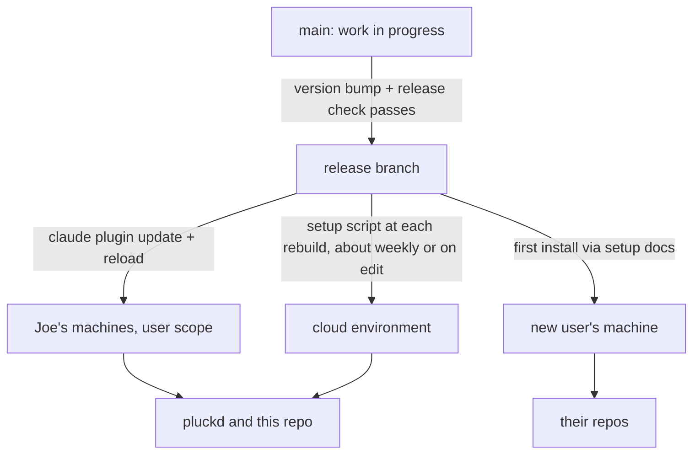
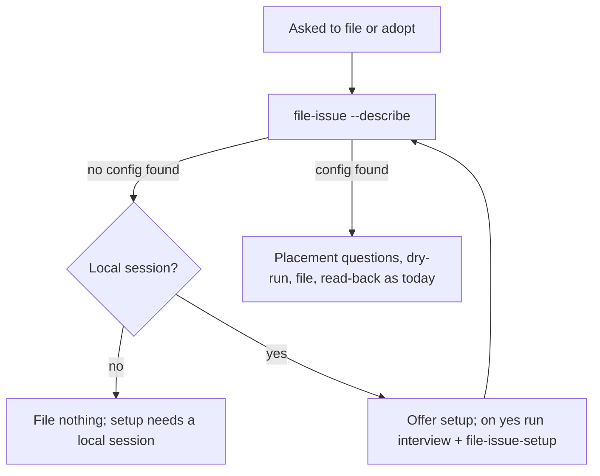

# Plugin Distribution - Plan

## Goal Capsule

- **Objective:** Every repo on the plugin runs the current release without anyone hand-copying, hand-editing, or running an update, and no install ever runs work that hasn't been released. photos stays on its pinned submodule.
- **Means:** Ship the skill and the engine together as one Claude Code plugin from this repo, installed from a release branch, with setup offered the first time someone files in an unconfigured repo (KTD1, KTD2).
- **Product authority:** Joe (repo owner). The Product Contract below wins on behavior. Key Technical Decisions win on mechanism. Issue #1 is the parent issue for this work.
- **Execution profile:** Deep. Seven units in this repo, one in pluckd (U8, its own PR in that repo).
- **Stop conditions:** Stop and ask Joe if U1 shows that a plugin source added at a branch doesn't follow that branch, or that auto-update doesn't pick up a moved branch, or if any unit would change the read-back or delta-write logic (R15).
- **Who finishes:** `ce-work` builds U1–U7 here and opens a PR. U8 is a PR in pluckd after a release exists. Joe pastes the setup script into the cloud environment and runs the second-person install.
- **Open blockers:** None.

---

## Product Contract

Product Contract preservation: changed after research and Joe's decisions on 2026-10-17. R2, R3, R4, R10, R12, R14, and R17 were rewritten in place. R2 now has releases arrive on their own, by Joe's decision to update local machines and cloud sessions the same way. R19 and R20 are new. The multi-repo cloud gap moved out of Scope Boundaries because R12's route covers it. Success Criteria now name pluckd only.

### Summary

This repo becomes a Claude Code plugin that ships the skill and the engine together, installed only from a release branch. A consuming repo keeps only its config, its issue templates, and settings entries for the plugin, and the skill reads that config at run time. An unconfigured repo gets an offer to set up, and pluckd moves onto the plugin.

### Problem Frame

Each consuming repo carries its own copy of the engine and a hand-filled copy of the skill, and fixes don't reach them. pluckd is pinned 5 commits behind the engine and has rebuilt its skill copy by hand on each of its last three pin bumps. Its copy still carries the doubled-article bug fixed upstream in 1b7ef3a.

Most of the hand-filled text is redundant. Of the template's seven placeholders, `{{FILE_ISSUE_CMD}}`, `{{SHAPES_LIST}}` (names only), and `{{DESIGN_LINE_BLOCK}}` restate config fields, and `{{BODY_FIELDS_NOTE}}` restates the repo's issue templates. `{{CONFIG_PATH}}` is the config's own location. Only the board's display name, the conventions-doc path, and each shape's one-line meaning have no home in the config today.

Cloud filing works only through a pluckd-specific workaround: its wrapper downloads the engine files at the pinned commit and keeps a hand-maintained file list that has to be re-checked on every pin bump. A new user faces five manual setup steps with nothing checking that the placeholders were filled or the config is valid.

### Key Decisions

- **Ship as a Claude Code plugin, skill and engine together.** One install and one update cover both, so they can't drift apart. (session-settled: user-directed — chosen over a GitHub CLI extension plus a separately installed skill, and over copying into each repo with a sync command: the extension still leaves a skill copy to drift, and per-repo copies are what drifted.) A mod was also considered: it is a plugin with a JavaScript hooks module, and adds nothing this tool needs. Governs R1, R2, R4.
- **Design for about two installers, and record what a public release would add without building it.** (session-settled: user-directed — chosen over designing for anyone installing publicly: about two people are expected, though the repo is public.) Governs the deferred list in Scope Boundaries.
- **Releases reach local machines and cloud sessions automatically, the same way.** (session-settled: user-directed — chosen over manual updates in both places, over manual locally with automatic cloud, and over per-repo pinning: the release branch and release check already decide what ships, so a manual step adds chores and lets repos fall behind.) A bad release spreads just as fast, so the release check and rollback carry the safety. Governs R2, R3, R14.
- **Releases are separate from work in progress.** (session-settled: user-directed — chosen over installing from main: a fresh install or cloud build from main would pick up unreleased work.) Governs R3, R13.
- **Cloud sessions take the newest release, installed by the cloud environment's setup script.** Joe confirmed the setup-script route works, and it also covers sessions with several repos attached. (session-settled: user-directed — chosen over a starter skill committed in each repo, and over no cloud filing: repo settings don't install plugins in cloud sessions, and a per-repo starter is one more copy to keep current.) Governs R12, R14.
- **An unconfigured repo gets a setup offer, which takes in issue #1.** (session-settled: user-directed — chosen over refusing and pointing to docs, and over staying out of the way: refusing leaves setup manual, and staying out of the way leaves a repo with no guardrail.) Governs R9, R10, R11, R19, R20.
- **Only pluckd migrates; photos stays on its pinned submodule.** (session-settled: user-directed — chosen over migrating photos too: that project is nearly complete, and its extra board audits are specific to it.) Governs R17.
- **A hook that blocks raw `gh` board writes comes later, as its own issue.** (session-settled: user-directed — chosen over shipping the hook in this plan, and over no hook: the written rule ships now and the hook follows.) Governs the follow-up list in Scope Boundaries.
- **Release safety comes from a check before publishing and a fast rollback, without per-repo pinning.** Every install follows the release branch, so publishing is the only gate. Governs R13, R14.
- **The three values with no config home become optional config fields.** The other placeholders already restate config or repo files, so the skill derives them instead. Governs R5, R6, R7.

### Requirements

**Packaging and updates**

- R1. The skill and the engine ship together as one Claude Code plugin published from this repo, and one install per machine makes them available in every repo on that machine.
- R2. A machine picks up the newest published release on its own at a session start after the release, and that moves every repo on the machine. Nobody runs an update command.
- R3. No install, whether a fresh one, an update, or a cloud environment build, ever receives work that hasn't been published as a release.

**What a consuming repo keeps**

- R4. A consuming repo keeps only its config, its `.github/ISSUE_TEMPLATE/` files, its settings entries that enable the plugin and allow its command, and one line in its `CLAUDE.md` (R19). It has no submodule, wrapper script, or skill copy.
- R5. The skill takes every repo-specific value from the repo's config and issue templates at run time, so nothing is filled in by hand.
- R6. The config gains three optional fields: the board's display name, the path to the repo's conventions doc, and a one-line meaning per shape. Without them the skill falls back to a neutral wording.
- R7. An existing config that passes today's validation keeps working without edits.
- R8. Follow-up commands the engine prints run as printed in a local session of the same repo.

**Repos with no config**

- R9. When asked to file or adopt in a repo with no config, the skill files nothing and offers to run setup.
- R10. Setup runs only in a local session. It checks the GitHub CLI's version and board permission, asks for the values it can't look up, writes and validates the config, copies the issue templates, and adds the settings entries before it reports success.
- R11. Setup never overwrites an existing config, issue template, settings entry, or `CLAUDE.md` line without asking first.
- R19. Setup adds one line to the repo's `CLAUDE.md`: when the file-issue skill isn't loaded, write nothing to the board and say the plugin is missing.
- R20. The person, never the agent, answers whether filings need human approval.

**Cloud sessions**

- R12. A cloud session gets the newest published release from its environment's setup script, with no per-repo version setting and no download workaround in the repo.

**Release safety**

- R13. A release is published only after the test suite passes and one dry run against a real board succeeds, both run from the release candidate.
- R14. A rollback publishes the previous release's content as a new release. It reaches a machine the same way any release does (R2), and a cloud environment at its next rebuild, which an edit to the setup script forces.

**Guardrails unchanged**

- R15. The placement refusals, duplicate check, dry-run, and read-back behave the same once packaged as they do today, and this work doesn't change the read-back or delta-write logic.
- R16. The skill stays the only supported way to write to the board in a configured repo, and it still tells the agent never to reach for the GitHub CLI to create or place an issue.

**Migration**

- R17. pluckd runs on the plugin. It drops its submodule, wrapper, and skill copy, then files or adopts one real issue whose read-back passes. photos keeps its pinned submodule and keeps working unchanged.
- R18. This repo files its own issues through the plugin, and its `CLAUDE.md` filing instructions point at the skill in place of the bare command.

### Key Flows

- F1. Set up a new repo
  - **Trigger:** Someone asks the agent to file an issue in a local session of a repo with the plugin installed and no config.
  - **Steps:** The skill refuses to file and offers setup (R9). On yes, setup checks the CLI, asks its questions, and writes and validates the config (R10, R20). It then copies the issue templates and adds the settings entries and `CLAUDE.md` line, asking before replacing anything (R11, R19). The original filing request then runs as normal.
  - **Outcome:** The repo is configured, and the first issue goes on the board through the guardrail.
- F2. Ship a fix
  - **Trigger:** A change on main is ready to reach consuming repos.
  - **Steps:** The release check runs on the candidate (R13), and the release branch moves to it. Each machine picks it up at its next session start (R2), and each cloud environment at its next rebuild (R12).
  - **Outcome:** Every repo on every machine, and every rebuilt cloud environment, runs the fix with no one running a command. Nothing on main that wasn't released reaches anyone (R3).
- F3. Roll back a bad release
  - **Trigger:** A published release breaks filing.
  - **Steps:** The previous release's content is published as a new release (R14). Machines pick it up at their next session start, and the cloud setup script gets an edit to force a rebuild.
  - **Outcome:** Filing works again without editing any consuming repo's files.

### Acceptance Examples

- AE1. **Covers R9, R10.** Given a repo with the plugin installed and no config, when the agent is asked to file an issue, then nothing is written to the board, and the agent offers setup before doing anything else.
- AE2. **Covers R11.** Given a repo that already has issue templates but no config, when setup runs, then it asks before replacing any existing template.
- AE3. **Covers R7.** Given a config with no `file_issue_cmd` or `human_review_required` field (photos' current shape), when the engine runs, then filing works and the skill treats human review as required.
- AE4. **Covers R3.** Given a commit on main that hasn't been released, when a machine installs fresh, updates, or a cloud environment rebuilds, then none of them receives that commit.
- AE5. **Covers R6.** Given a config with no board display name, when the skill describes the board, then it uses the neutral wording and leaves no unfilled placeholder text.
- AE6. **Covers R10.** Given a cloud session, when setup is asked to run, then it refuses and says setup needs a local session.

### Success Criteria

- A second person, on their own machine, installs the plugin and sets up a new repo with no manual copy-and-edit step. This is the Done-when of issue #1, tested on a real second install.
- After pluckd migrates, one release reaches pluckd on Joe's machine and in a cloud session with no update command, and pluckd needs no commit to receive it.

### Scope Boundaries

- **photos and photo-consolidation.** They are two clones of one GitHub repo, which keeps its pinned submodule. The engine's files stay at this repo's root so that pin keeps working.
- **Other agents and tools.** The plugin works only in Claude Code.
- **Org-owned boards.** The engine assumes a user-owned board. Setup says so and stops when the board's owner is an organization.
- **Running the engine by hand.** A person can still run the plugin's command from a terminal, but nothing here makes that a goal.
- **The submodule path.** Once pluckd migrates, the submodule is no longer a documented way to install.
- **Considered and not built:** a second config location, so pluckd's config could stay in `scripts/`. pluckd's migration moves the file instead, which costs one rename. Revisit if a consumer can't keep its config at the repo root.
- **Considered and not built:** pinning a version in the cloud setup script. It would make cloud runs exact but needs an edit on every release. Revisit if cloud sessions running a release up to a week old causes a real problem.
- **Deferred for a public release:** a listing in a public plugin catalog, release notes for each version, a promise not to change behavior within a minor version, and install docs written for a stranger.

### Deferred to Follow-Up Work

- A plugin hook, paired with a permission rule, that blocks raw `gh issue create` and `gh project item-add` and points the agent at the skill. To be filed as a child of #1.

### Dependencies / Assumptions

- **Confirmed by Joe, 2026-10-17:** a cloud environment's setup script can run `claude plugin marketplace add` and `claude plugin install`, and the plugin loads in the session. pluckd's `scripts/cloud/setup-box.sh` already installs the Compound Engineering plugin this way.
- **Documented:** a cloud environment is cached and rebuilt when its setup script changes, or after roughly seven days. A cloud session can therefore run a release up to about a week old (R12, R14).
- **Unverified, tested first in U1:** a plugin source added at `owner/repo#release` keeps following that branch, and auto-update picks up a moved `release` at session start.
- **Documented:** a cloud session doesn't install plugins named in a repo's `.claude/settings.json`, with one repo attached or several.
- GitHub reads issue templates only from a repo's own `.github/ISSUE_TEMPLATE/`, so every consuming repo keeps its own copy (R4).

### Sources / Research

- Issue #1 and its comment linking `docs/plans/2026-08-31-002-feat-configurable-human-review-plan.md`, the setup question for `human_review_required`.
- `SKILL.template.md` header comment, which lists the seven placeholders.
- `docs/SETUP.md`, the five manual steps this replaces.
- pluckd `scripts/file_issue.sh` (cloud download path and `ENGINE_FILES` list), pluckd `docs/cloud-sessions.md`, and pluckd `scripts/cloud/setup-box.sh` (`install_ce_plugin`).
- Claude Code docs, fetched 2026-10-17: plugins reference (`${CLAUDE_PLUGIN_ROOT}` is substituted in skill content but not set for the agent's shell commands, and `bin/` goes on the shell's PATH), marketplace reference (`ref`/`sha` sources, and installed copies change only when the version changes), cloud-environments ("What carries over" table and setup scripts), and mods overview.

---

## Planning Contract

### Key Technical Decisions

- KTD1. **The plugin root is this repo's root, with a marketplace file that lists it by relative path.** The engine's three files stay where they are, so photos' pinned submodule and every existing test keep their paths. Installed copies also carry the tests and docs. That is harmless, and cheaper than moving the engine and re-pointing photos. Governs R1, R17.
- KTD2. **A `release` branch is the only install source.** Development stays on main. Publishing a release means bumping the version in the plugin manifest on main, running the release check, then fast-forwarding `release` to that commit. Every install adds the marketplace as `jffriend/ai-issue-management-skill#release`: Joe's machines, the cloud setup script, and the setup docs for a new user. Auto-update is turned on for this marketplace, which is off by default for a third-party marketplace, so each machine takes a new release at session start. The install steps in `docs/SETUP.md` turn it on, and so does the cloud setup script. Instantiates the Key Decision on separating releases (R3, R13), and is checked first in U1.
- KTD3. **The engine runs as `file-issue`, a command the plugin puts on the shell's PATH.** `bin/file-issue` is a small script that runs the engine by its real path, never a symlink, because the engine finds `board.sh` and `issue_text.py` beside itself. The skill and every printed follow-up command use `file-issue`, which stays the same across versions and in cloud sessions. Governs R8.
- KTD4. **The engine finds the config itself, in one place.** With no `--config`, it walks up from the working directory to the nearest folder holding a `.git` entry (a folder, or a file in a worktree), in bash with no `git` call, and reads `file-issue.config.json` there. When it finds none, it refuses with its own exit code and names the folder it searched from. An explicit `--config` still wins, so photos' wrapper and the tests keep working. This repo's `config.json` is renamed to `file-issue.config.json`, and U8 moves pluckd's config to its repo root. Governs R5, R8, R9.
- KTD5. **A `--describe` mode is the skill's only source of repo values.** It prints the config path it found, the board's display name, each shape with its meaning, the conventions doc, `human_review_required` (or that it is absent and defaults to required), whether this is a cloud session, the plugin version, and the GitHub CLI version. The skill runs it first, so the values the skill shows the agent are the same ones the engine enforces. Governs R5, R6, AE3, AE5.
- KTD6. **`file_issue_cmd` stays optional, and the default printed command depends on how the config was found.** When the config was found by discovery, the default is `file-issue`. When `--config` was given, the default stays today's `bash <engine path> --config <config path>`, so photos and the test harness print a command that finds the same config. A config that sets `file_issue_cmd` is still honored (R7). pluckd's migration removes its value, which names the wrapper U8 deletes. Governs R7, R8.
- KTD7. **Setup is a separate script, `setup.sh`, run as `file-issue-setup`.** It does only what a script can check and the agent can't be trusted to do:
  - refuse in a cloud session
  - refuse a GitHub CLI below 2.94.0 or without the `project` scope
  - refuse an org-owned board
  - look up `project_id`
  - require `human_review_required` as an explicit flag with no default
  - write and validate the config, refusing to replace an existing one
  - copy each issue template, refusing any that exist unless told to replace it

  The skill runs the interview and makes the settings and `CLAUDE.md` edits, asking first per R11. Keeping setup out of `file_issue.sh` leaves the filing engine's tests and history alone. Governs R10, R11, R20, AE2, AE6.
- KTD8. **Engine strings that name one consumer become generic.** The move comment's "Recorded automatically by `scripts/file_issue.sh`" and the help block's `docs/WORKFLOW.md` reference now name the file-issue engine and the repo's conventions doc. Neither touches read-back or delta-write. Governs R15.
- KTD9. **The release check runs by hand from a checkout of the candidate.** The check has four parts:
  - CI is green on main for the candidate commit
  - `python3 -m unittest discover tests` passes
  - `claude plugin validate .` passes
  - one dry run against this repo's own board, made through the skill in a `claude --plugin-dir <candidate checkout>` session, so the plugin's command path and skill text are exercised as installs see them

  Releases are rare, so a release workflow isn't worth building. Governs R13.
- KTD10. **Development loads the plugin from the working copy, never from an install.** `claude --plugin-dir <checkout>` runs the work-in-progress skill. The release-check dry run (KTD9) writes nothing, so it can safely run against a real board. Whether a working-copy load collides with an installed copy of the same name is checked in U1. Governs R3, R18.

### High-Level Technical Design

How a release reaches each install. Nothing installs from main.

What the skill does when asked to file. The engine owns every check, and the skill reads its answers.

### Implementation Constraints

- Only bash, jq, python3, and gh (`CODING_STANDARDS.md`).
- Read `docs/solutions/` before any change near the read-back or delta-write logic. No unit here should need one (R15).
- The placement refusals, duplicate check, dry-run, and read-back are untouched (R15).

### System-Wide Impact

- **The agent's approval gate.** `human_review_required` decides whether an agent files without asking. R20 and KTD7 keep the person as the one who sets it, and the skill still treats an unreadable or absent value as required.
- **Permission rules.** Every consumer's allow rule moves from a wrapper path to `file-issue`. A missed rule makes each filing prompt for permission, which is visible and safe.
- **photos.** It keeps running the engine from its pinned submodule by the root file paths, which KTD1 leaves unchanged. Engine changes here never reach it until someone bumps its pin.
- **CI.** The test workflow is unchanged. Its `paths-ignore` list already lets `.claude-plugin/`, `bin/`, and `skills/` changes run the tests.
- **Printed commands in existing issues.** Comments and notices written before this work name `bash scripts/file_issue.sh`. They stay as history and aren't rewritten.

### Risks

| Risk | Decision |
|---|---|
| A plugin source added at a branch doesn't follow it on update | U1 checks it first, and the plan stops for Joe if it fails |
| A release ships without a version bump, so no machine picks it up | `docs/RELEASING.md` puts the bump first, and U2's test checks a version exists. Accepted: the release check's `--plugin-dir` run doesn't catch it, but the session's plugin version shows it the next day |
| A bad release reaches every local session at its next start | Accepted with the automatic-update decision. The release check (R13) gates it, and a rollback (R14) spreads the same way |
| `release` is moved to an untested commit by mistake | Accepted: only Joe moves it, by following `docs/RELEASING.md`. A rollback (R14) recovers |
| Cloud sessions run a release up to a week old | Accepted (Scope Boundaries). An edit to the setup script forces a rebuild |
| A working-copy load collides with the installed plugin of the same name | U1 checks it. If they collide, development uses a session with the installed copy disabled |
| The GitHub CLI is too old, which fails with no clear message | U4's setup check refuses below 2.94.0 |

### Sequencing

U1 first: it can stop the plan. U2 and U3 can then go in either order. U4 follows U3. U5 needs U3's describe mode and U4's setup command. U6 needs U2. U7 follows U5 and U6. After the first release, Joe installs the plugin. U8 then runs in pluckd, and the second-person install comes after it.

---

## Implementation Units

### U1. Confirm branch tracking and the working-copy load

**Goal:** Prove the two unverified mechanisms before building on them.

**Requirements:** R3, R2. KTD2, KTD10.

**Dependencies:** None.

**Files:** `docs/RELEASING.md` (records the results).

**Approach:**
1. Make a scratch marketplace repo or branch whose plugin version changes on a branch named `release`. Add it with `#release`, install it, move the branch, run the update command, and confirm the new version arrives. Then move main without moving `release`, and confirm an update and a fresh install both stay on the release. Record the exact command sequence that worked, including whether a marketplace refresh must run before the plugin update.
2. Turn on auto-update for the scratch marketplace, move `release`, start a new session, and confirm the new version loads with no command. Record whether a reload or a second session start is needed.
3. With the plugin installed, start a session with `--plugin-dir` pointed at a working copy, and record which copy's skill loads.
4. If step 1 or 2 fails, stop and bring Joe the result before any other unit.

**Execution note:** Runtime smoke check, not unit tests.

**Test expectation:** none -- this unit checks Claude Code's behavior. It ships no code.

**Verification:** `docs/RELEASING.md` records both results, with the Claude Code version they were checked on.

### U2. Package the repo as a plugin

**Goal:** This repo installs as a plugin that puts `file-issue` and `file-issue-setup` on the shell's PATH.

**Requirements:** R1, R8. KTD1, KTD3.

**Dependencies:** None.

**Files:**
- `.claude-plugin/plugin.json` (name `file-issue`, version)
- `.claude-plugin/marketplace.json` (one plugin, relative-path source)
- `bin/file-issue`
- `bin/file-issue-setup`
- `tests/test_plugin_package.py`

**Approach:**
1. Model the manifest and marketplace files on the installed Compound Engineering plugin under the user's plugin cache.
2. Each `bin/` script resolves its own real location and runs the matching file one directory up, passing every argument through.
3. Leave `file_issue.sh`, `board.sh`, and `issue_text.py` at the root.

**Patterns to follow:** The Compound Engineering plugin's `.claude-plugin/` layout. `tests/test_engine_gating.py`'s `Harness`, which runs the engine as a subprocess with a fake `gh` first on PATH.

**Test scenarios:**
- `bin/file-issue --help` run from a different working directory prints the engine's help.
- `bin/file-issue` reached through a symlink still finds `board.sh`. It runs a `--dry-run` against the fake `gh` and gets the board neighborhood.
- Arguments with spaces and quotes reach the engine unchanged.
- `plugin.json` and `marketplace.json` parse, agree on the plugin name, and `plugin.json` carries a version string.

**Verification:** `claude plugin validate .` passes, and a `--plugin-dir` session can run `file-issue --help`.

### U3. Config discovery, describe mode, and generic engine strings

**Goal:** The engine finds the repo's config on its own and reports every repo value the skill needs.

**Requirements:** R5, R6, R7, R8, R9, R15. KTD4, KTD5, KTD6, KTD8. AE3, AE5.

**Dependencies:** None.

**Files:**
- `file_issue.sh`
- `config.json` renamed to `file-issue.config.json`
- `config.example.json` (repo identity replaced with placeholders, the three R6 fields shown)
- `tests/test_engine_gating.py`
- `tests/test_engine_config.py` (new)

**Approach:**
1. Discover the config per KTD4 when `--config` is absent, and add the no-config exit with a message that names the folder searched from.
2. Add `--describe` per KTD5. It needs a config (found or given) and makes no network call except `gh --version`.
3. Set the default printed follow-up command per KTD6. Each `reverify_command` call site keeps its current shape.
4. Make the move comment and help text generic (KTD8), and update `test_the_comment_says_who_wrote_it_and_why` to match.
5. Leave the config fields the engine validates unchanged. The R6 fields are read only by `--describe`.

**Execution note:** Add the discovery and describe tests first. The gating suite must stay green without edits other than the two strings in step 4.

**Patterns to follow:** The existing offline config validation at the top of `file_issue.sh`, which names the bad field before any network call.

**Test scenarios:**
- Run from a subfolder of a temp repo (a folder with a `.git` marker) with `file-issue.config.json` at its root, the engine uses that config.
- With a `.git` file instead of a folder, as in a worktree, discovery finds the same root.
- With no config at the root, the engine exits with the no-config code, names the folder it searched from, and writes nothing.
- Run from a folder with no `.git` above it, the engine exits with the no-config code.
- An explicit `--config` wins over a discovered file.
- Covers AE3. A config with no `file_issue_cmd` and no `human_review_required` passes validation, and `--describe` reports review as absent, defaulting to required.
- Covers AE5. With no board display name, `--describe` reports none, and the printed text holds no `{{`.
- `--describe` lists each shape with its meaning when given, and its name alone when not.
- With `file_issue_cmd` unset and the config discovered, the cloud `BOARD NOT CHECKED` notice prints `file-issue --adopt …`.
- With `file_issue_cmd` unset and `--config` given, the notice prints today's `bash <engine path> --config <config path>` form, so the existing gating tests that assert it pass unchanged.
- With `file_issue_cmd` set, the notice prints that value, as `test_the_cloud_notice_names_the_configured_command_not_cloud_paths` asserts today.

**Verification:** The full suite passes. `bin/file-issue --describe` in this repo prints this repo's board and shapes.

### U4. Setup command

**Goal:** `file-issue-setup` writes a valid config and copies the issue templates, refusing every case the agent shouldn't decide.

**Requirements:** R10, R11, R20. KTD7. AE2, AE6.

**Dependencies:** U3 (validation reused through `--describe` on the written config).

**Files:**
- `setup.sh`
- `tests/test_setup.py`
- `.github/ISSUE_TEMPLATE/*.md` and `config.yml` (comments name the skill in place of `file_issue.sh`)

**Approach:**
1. Refuse when `CLAUDE_CODE_REMOTE` is `true`.
2. Read `gh --version` and refuse below 2.94.0. Check the token has the `project` scope, and refuse with the `gh auth refresh` command when it doesn't.
3. Take repo, owner, project number, shapes, and `human_review_required` as flags, with no default for review. Take the three R6 fields as optional flags.
4. Refuse an org-owned board. Look up `project_id` with `gh project view`.
5. Write `file-issue.config.json` at the repo root found per KTD4, refusing if a config already exists there. Then validate it with `file-issue --describe`.
6. Copy each issue template, skipping and naming any that exist unless a replace flag names it.
7. Print the settings entries and the `CLAUDE.md` line (R19) for the skill to add.

**Patterns to follow:** The offline validation and fake-`gh` harness in `tests/test_engine_gating.py`.

**Test scenarios:**
- Covers AE6. With `CLAUDE_CODE_REMOTE=true`, setup exits non-zero and writes nothing.
- A fake `gh` reporting 2.90.0 makes setup refuse and name 2.94.0.
- A token without the `project` scope makes setup refuse and print the refresh command.
- Without the review flag, setup refuses and names the flag.
- An org owner makes setup refuse and say org boards aren't supported.
- With valid flags in an empty repo, setup writes a config that passes `--describe`, with the looked-up `project_id`.
- With an existing config, setup refuses and leaves it unchanged.
- Covers AE2. With an existing `bug.md`, setup copies the other templates, skips `bug.md`, and names it. With the replace flag for `bug.md`, it replaces only that file.

**Verification:** The suite passes, and a scratch repo set up by hand with `file-issue-setup` files a dry run.

### U5. Ship the generic skill

**Goal:** One skill that works in any configured repo, refuses and offers setup elsewhere, and needs no hand-filling.

**Requirements:** R5, R9, R10, R11, R16, R19, R20. KTD3, KTD5. AE1, AE5.

**Dependencies:** U3, U4.

**Files:**
- `skills/file-issue/SKILL.md` (new, from `SKILL.template.md`)
- `SKILL.template.md` (deleted)
- `tests/test_engine_skill.py`

**Approach:**
1. Start the skill with `file-issue --describe`, run from inside the target repo's clone. When the session holds several repos, the agent changes into the target repo's folder first. Use the returned values wherever the template had placeholders, with neutral wording when a field is absent.
2. On the no-config exit, file nothing and name the folder searched from. In a local session, offer setup. In a cloud session, say setup needs a local session.
3. Write the setup interview:
   1. The person answers each value, and the agent never chooses review on their behalf (R20).
   2. Run `file-issue-setup`.
   3. Show the settings entries and `CLAUDE.md` line it printed, and add each one only after the person says yes (R11, R19).
4. Carry every generic section over unchanged: the one rule, the four placement questions, the dry run, duplicates, the read-back, cloud filing, and the must-never list. Keep the no-`gh` rule word for word.
5. Replace each `{{FILE_ISSUE_CMD}}` with `file-issue`.

**Patterns to follow:** `SKILL.template.md`'s current text. The conformance tests left behind in photos' `tests/test_file_issue_skill.py` (`SkillDrivesTheScript`, `NoReimplementation`, `FrontmatterKeepsTheSkillReachable`).

**Test scenarios:**
- Covers AE5. The skill holds no `{{`.
- Every flag the skill names is an arm of `file_issue.sh`'s argument parser or of `setup.sh`'s.
- The never-use-`gh issue create` rule is present, and no sentence in the skill makes an exception to it.
- The frontmatter names the skill `file-issue`, and its description says it is the way to put work on the board.
- The skill tells the agent to run `--describe` before any filing step, from inside the target repo's clone.
- Covers AE1. The skill's no-config branch says to file nothing and offer setup, and the cloud branch says setup needs a local session.
- The setup section says the person answers the review question.
- The doubled-article test runs against the shipped skill with the neutral board wording.

**Verification:** In a `--plugin-dir` session, asking to file in a scratch repo with no config gets the setup offer and writes nothing.

### U6. Release branch and release procedure

**Goal:** Publishing and rolling back follow one written procedure, and nothing reaches installs except through it.

**Requirements:** R3, R13, R14. KTD2, KTD9.

**Dependencies:** U1, U2.

**Files:**
- `docs/RELEASING.md`

**Approach:**
1. Write the release steps from KTD2 and KTD9, including what to paste into a cloud setup script.
2. Write the rollback so unreleased work on main is untouched:
   1. Make one commit on top of `release` that restores the previous release's files and sets a version higher than the bad release's.
   2. Run the release check, then push `release`, which is still a fast-forward.
   3. Merge `release` into main, keeping main's files, so main's next release bumps past the rollback version.
   4. Edit the cloud setup script to force a rebuild.
3. Create the `release` branch at the first release.

**Test expectation:** none -- procedure only. The suite itself covers behavior.

**Verification:** The first release follows `docs/RELEASING.md` start to finish.

### U7. Rewrite the docs and dogfood the plugin here

**Goal:** Every doc describes the plugin, and this repo files through its own skill.

**Requirements:** R4, R18. KTD10.

**Dependencies:** U5, U6.

**Files:**
- `README.md`
- `docs/SETUP.md`
- `docs/USAGE.md`
- `docs/CONCEPTS.md` (only where it names the template)
- `CLAUDE.md`

**Approach:**
1. `README.md`: replace the "no package yet" and submodule lines with the plugin install.
2. `docs/SETUP.md`: replace the five steps with install from `#release` with auto-update on (KTD2), then let the skill run setup. Add the three R6 fields to the config schema. Remove "no automated setup interview".
3. `docs/USAGE.md`: replace the `bash file_issue.sh --config config.json` examples with `file-issue`.
4. `CLAUDE.md`: point the filing section at the skill, add the plugin-missing line (R19), and say development uses `--plugin-dir` (KTD10).

**Test expectation:** none -- docs only.

**Verification:** No doc names the submodule as the way to install, a bare `bash file_issue.sh --config` command, or `SKILL.template.md`. A filing from this repo goes through the installed skill.

### U8. Migrate pluckd

**Goal:** pluckd runs on the released plugin with no submodule, wrapper, or skill copy.

**Target repo:** pluckd. This unit is its own PR there.

**Requirements:** R4, R7, R12, R17. KTD2, KTD6.

**Dependencies:** A published release (U6). The plugin installed on Joe's machine.

**Files (in pluckd):**
- `scripts/cloud/setup-box.sh`
- `scripts/file-issue.config.json` (moved to `file-issue.config.json` at the repo root)
- `scripts/file_issue.sh` (deleted)
- `.claude/skills/file-issue/` (deleted)
- `.gitmodules`
- `scripts/ai-issue-management-skill` (submodule removed)
- `.claude/settings.json`
- `CODING_STANDARDS.md`
- `CLAUDE.md`
- `docs/board.md`
- `docs/README.md`
- `docs/cloud-sessions.md`
- `docs/claude-permissions.md`
- `docs/browser-testing.md`

**Approach:**
1. Add the plugin install from `#release` to `setup-box.sh` beside `install_ce_plugin`. Joe pastes it into the cloud environment, and a cloud session confirms `file-issue --describe` runs, before step 2 merges.
2. In one PR:
   1. Move the board name, conventions doc (`docs/board.md`), and shape meanings from the hand-filled skill into the config's R6 fields, and remove `file_issue_cmd`.
   2. Delete the wrapper, skill copy, and submodule.
   3. Replace the `Bash(bash scripts/file_issue.sh *)` allow rule with one for `file-issue`, and add the plugin's settings entries.
   4. Change the `CODING_STANDARDS.md` guardrail line about the submodule setup.
   5. Add the plugin-missing line to `CLAUDE.md` (R19), and update the docs named above.
3. Search pluckd for `scripts/file_issue.sh`, `ai-issue-management-skill`, and `ENGINE_FILES`, and resolve every hit, so no check names a deleted script.
4. File or adopt one real issue and confirm the read-back passes.

**Test expectation:** none -- pluckd has no tests on the engine. Proof is the real filing in step 4 and the cloud check in step 1.

**Verification:** The search in step 3 finds nothing. One real filing's read-back passes locally and in a cloud session.

---

## Verification Contract

| Check | Command or action | Applies to |
|---|---|---|
| Test suite | `python3 -m unittest discover tests` | U2–U5, every release |
| Plugin manifest | `claude plugin validate .` | U2, every release |
| CI on main | green for the candidate commit | every release (R13) |
| Real-board dry run | a dry run through the skill in a `claude --plugin-dir <candidate checkout>` session, against this repo's board | every release (R13) |
| Mechanism check | U1's recorded results | before U2 |
| pluckd real filing | one filing or adoption with a passing read-back, locally and in a cloud session | U8 |
| Second install | a second person installs from `#release` and sets up a new repo | Success Criteria |

---

## Definition of Done

- U1–U7 are merged to main here, and the first release is published from the `release` branch after the full release check (KTD9).
- `bin/file-issue --describe` and a dry run work in this repo from the installed plugin.
- U8 is merged in pluckd, and its real filing's read-back passed locally and in a cloud session.
- A second person has installed the plugin and set up a new repo with no copy-and-edit step.
- photos still files through its pinned submodule.
- No abandoned-attempt code, scratch marketplace, or test repo remains in either repo.
- The hook issue is filed as a child of #1.
